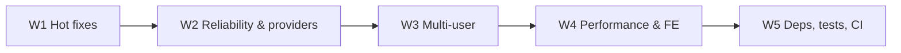

# Project Evolution Roadmap v19 — Hardening, Provider Unification, Multi-User Readiness & Performance

**Date:** 2026-11-07  
**Status:** Approved by User (design) — awaiting spec review  
**Parent:** Post v18 (Tool Orchestrator, Universal Web Search, Product Tour, Theme Modernization)  
**Target Deployment Profile:** Small trusted team (2–10 users) on a shared self-hosted server (Docker Compose behind TLS reverse proxy); Electron desktop shell is secondary  
**Scope:** Five sequential gated waves. Stabilization first; no new end-user features except the multi-user controls required by the deployment profile  
**Approach:** Approach A — risk-ordered waves: Hot Fixes → Reliability & Provider Layer → Multi-User Readiness → Performance & Frontend → Dependencies, Tests & CI

**Non-goals (for v19):**
- React 19, Express 5, Jest 30, `openai` 7, `@google/genai` 3, TypeScript 7, Prisma 8 (deferred to a dedicated v20 upgrade wave)
- i18n (UI stays Ukrainian-only)
- Electron code signing, `@electron/fuses`, auto-update feed, Electron GUI E2E
- New assistant capabilities (vector long-term memory, MCP client, multi-model comparison, ReAct fallback, destructive tools)
- Redis / BullMQ, horizontal scaling, billing

---

## 1. Audit Baseline (2026-11-07)

| Area | Lint | Typecheck | Tests | Prod `npm audit` |
|------|------|-----------|-------|------------------|
| Backend | clean | clean | 673/673 (73 suites) | 3 moderate (`qs`, `uuid`) |
| Frontend | 20 warnings (`any`, `max-lines`) | clean | 256/256 (54 files) | 2 moderate (`react-router` 6) |

Full audit produced ~150 findings (10 High). Verified-by-reading High findings that drive W1:

- `backend/src/services/tools/actionResolver.ts:89` executes the tool **before** the atomic `updateMany` claim at `:106` → concurrent approvals double-execute write tools.
- `frontend/src/hooks/useConversationHistory.ts:55` — `setMessages` is a no-op without `conversationId` → first-turn messages of a brand-new conversation are written nowhere.
- `desktop/src/main.ts:111-124` — `setWindowOpenHandler` / `will-navigate` call `shell.openExternal` without `isSafeExternalUrl`.
- `docker-compose.prod.yml` resets Postgres ports but not backend `5000:5000` → API exposed bypassing nginx.
- `frontend/build/index.html` modulepreloads `jspdf-*.js` (401 KB) on every page load (`vite.config.mjs` `manualChunks`).

Unverified-but-plausible items are flagged "(verify)" and must be reproduced by a failing test before fixing.

---

## 2. Wave Sequence & Gates

**Gate for every wave:** each fix has a regression test written first (red → green); backend + frontend lint, typecheck, unit tests and `vite build` green; desktop `npm test` green when touched; a `v19.N` git tag at wave end; `specs/README.md` status updated.

---

## 3. W1 — Security & Correctness Hot Fixes (2–3 days, no architectural change)

| # | Problem | Fix |
|---|---------|-----|
| 1.1 | Tool approval double-execution; reject also non-atomic | Claim first: `updateMany({id, status:'pending'} → 'executing')`, `count===0` → 409. Execute. Then set `approved` / `failed` with `resultSummary`. Reject uses the same atomic claim. Remove the redundant second `update`. Test: two concurrent approvals → exactly one `execute` call. |
| 1.2 | Client disconnect may not abort generation (verify) — `utils/requestAbort.ts` listens on `req` | Listen on `res.on('close')` guarded by `!res.writableEnded`. Test against a real HTTP server socket. |
| 1.3 | First-turn reply lost; stream not aborted on conversation switch | On SSE `init` write optimistic + final messages to `queryKeys.history(newId)`; invalidate that key after `done`. Effect cleanup aborts `abortRef` and cancels rAF on unmount / `conversationId` change. `renderHook` tests with a mocked SSE stream. |
| 1.4 | Fallback to `/send` re-sends after mid-stream failure | Fall back only if zero bytes were received from the stream. |
| 1.5 | Generation params trusted from client; saved settings ignored; unbounded attachment content | In `chat/prepare.ts`: merge user settings → client override → clamp to validator bounds → whitelist option keys. Validate `attachments[].content` ≤ 12 000 chars and total ≤ 60 000. |
| 1.6 | Electron `openExternal` without protocol check | `isSafeExternalUrl` in both handlers; deny `will-attach-webview`; `session.setPermissionRequestHandler` deny-by-default (allow microphone only for app origin). |
| 1.7 | Prod compose exposure | Backend `ports: !reset []`; `SEARXNG_SECRET` from `.env` (required in prod); dev Postgres bound to `127.0.0.1`. |
| 1.8 | `multer` 1.x DoS CVEs | Upgrade to `multer@^2`; map `MulterError`/filter rejections to 400/413; random stored filename + validated extension. |
| 1.9 | React Query cache survives logout | `queryClient.clear()` on logout and on refresh failure / session expiry. |
| 1.10 | Artifact sandbox navigation / message spoofing; Markdown links navigate the app | Sandbox checks `event.source === window.parent`; inject `<meta http-equiv="Content-Security-Policy">` + intercept `location`/`<a>`/`<meta refresh>` navigation inside the sandbox (block & notify parent). Custom Markdown `a` renderer: `target="_blank" rel="noopener noreferrer"` (Electron → `openExternal` IPC); custom `img` restricted by CSP. |
| 1.11 | Indirect prompt injection via RAG / memory / `search_documents` | Wrap retrieved chunks and memory tool results in `<untrusted_document>` tags with the same disclaimer used for web results; move retrieved content out of the `system` role into a user/tool-role context block. |
| 1.12 | jsPDF preloaded globally | Remove `jspdf` and react rules from `manualChunks` (or migrate to rolldown `advancedChunks`); CI check that `build/index.html` contains no `jspdf` preload. |

**Done when:** all 12 items merged with tests; tag `v19.0`.

---

## 4. W2 — Reliability & Provider Layer (~1 week)

### 4.1 `ProviderAdapter`
- Single interface in `services/providers/`: `send(messages, opts, signal)`, `stream(messages, opts, signal, onToken)`, `capabilities(model)`.
- Shared helpers: `normalizeOptions` (clamp; `max_completion_tokens` and no `temperature` for o-series / gpt-5), `withTimeout` (explicit `timeout` + `maxRetries` per request; idle-stream watchdog, default 60 s without a token), `accumulateToolCalls` (shared OpenAI/Ollama), `mapProviderError`.
- `signal` passed on every path, including non-streaming OpenAI/Ollama.
- `ProviderFactory` throws `ChatError(400)` for unknown providers; remove `as SendFn` / `as StreamFn` casts.
- One `resolveProviderKey(userId, provider)` replaces three key resolvers (shared-key policy hook point for W3).

### 4.2 Unified turn pipeline
- `runTurn(input, { stream, tools })` replaces `ChatService.sendMessage`, `ChatService.streamMessage` and the orchestrator's non-tool branch.
- Tool enablement resolved server-side: `UserSettings.toolsEnabled` → client override → model capability.

### 4.3 Model configuration
- `config/models.ts`: env-overridable defaults per provider + per-model capability/parameter table (tools, vision, accepted params).
- Ollama capabilities from `POST /api/show` with a 10-minute cache (closes v18 W1 §3.3); name heuristics only as fallback.
- Remove `gpt-3.5-turbo` / dated `claude-3-5-*` defaults everywhere (incl. Prisma default via migration); refresh `modelsService` seeds.
- `tokenCostCalculator`: exact-or-longest-prefix match instead of substring.

### 4.4 Gemini tool calling
- Proper `functionCall` / `functionResponse` parts; unique call IDs; never combine `googleSearch` with `functionDeclarations`; HTTP 400 mapped to a distinct error (not "invalid API key"); token-callback errors abort the stream.

### 4.5 Orchestrator
- Sum `tokenUsage` across iterations; persist exactly the text the user saw; run read tools via `Promise.all` with one assistant message carrying all `tool_calls`; store a truncated, sanitized result summary in `tool_trace` / SSE.

### 4.6 Server runtime
- `import 'dotenv/config'` as first line; split `server.ts` → `app.ts` + `index.ts`.
- Graceful shutdown: SIGTERM/SIGINT → stop accepting → drain SSE and document jobs (timeout 25 s) → `prisma.$disconnect()`; handlers for `unhandledRejection` / `uncaughtException`.
- `app.set('trust proxy', 1)`.
- SSE: `flushHeaders()` early, `:ping` every 15 s, `X-Accel-Buffering: no`; `token_usage` flag set only by the real event.
- Request-scoped child logger via `AsyncLocalStorage`; response-time log line.

### 4.7 Conversation memory
- Summary generation uses the user's resolved key; per-conversation in-flight guard; `messagesSinceSummary` counter on `Conversation` instead of per-turn `COUNT(*)`.

**Tests:** provider tests migrated to the adapter contract; Gemini/Claude tool-loop message formatting; timeouts & idle watchdog; graceful shutdown. **Tag:** `v19.1`.

---

## 5. W3 — Multi-User Readiness (~1 week)

### 5.1 Roles
- `User.role` enum `admin | member` (migration). Bootstrap admin = `ADMIN_EMAIL` env, else first registered user. `requireAdmin` middleware.

### 5.2 Shared keys & quotas
- `ALLOW_SHARED_PROVIDER_KEYS` (default `false` in production). User's own key always wins.
- `UsageLedger` table: `userId`, `date`, `provider`, `model`, `promptTokens`, `completionTokens`, `costUsd`, `sharedKey` (bool). Written after every turn and every summary generation.
- Daily per-user limit applies only to shared-key usage: `SHARED_KEY_DAILY_LIMIT_USD` default, per-user override by admin. Exceeded → HTTP 429 with code `QUOTA_EXCEEDED`; UI shows "Ліміт на сьогодні вичерпано — додайте власний ключ".

### 5.3 Admin panel (Settings tab, admin-only)
- Users list: role, blocked flag, daily limit override.
- Spend per user / model for day and month.
- One-time invite links (expiring, single use). With `ALLOW_REGISTRATION=false`, registration is invite-only.

### 5.4 Auth & rate limiting
- Chat rate limit keyed by `userId` (fallback IP); per-email login throttling.
- Email change requires current password and is normalized; password-change endpoint; credential change revokes all refresh tokens.
- Generic registration response (no enumeration). JWT `iss` / `aud` claims verified.
- Public `/api/health` minimal (`status`, `db`); details behind auth.
- PII-free logs: log `req.path`, hash emails and search queries.

### 5.5 Deployment & operations
- Backup sidecar (`pg_dump` cron; 7 daily + 4 weekly retention) and `docs/ops/backup-restore.md` with a tested restore procedure; "backup before upgrade" step documented.
- Compose healthchecks for backend and SearXNG; `depends_on: condition: service_healthy`; `json-file` log rotation (10 MB × 3); pinned image versions; `CORS_ORIGIN` required in prod; Caddy TLS example (`deploy/Caddyfile.example`).
- Remove runtime `prisma generate` from `docker-entrypoint.sh`.
- Periodic maintenance job: prune expired `refresh_tokens` and `pending_tool_actions` (with `expires_at` indexes); document watchdog on a timer instead of every `GET /documents`.

**Tests:** role guards (403 for member), quota 429, ledger writes, session revocation, invite flow. **Tag:** `v19.2`.

---

## 6. W4 — Performance & Frontend (~1 week)

### 6.1 Streaming & rendering
- Tokens only through the rAF-batched buffer; commit to `messages` on `done`.
- Markdown parsed for completed blocks only; trailing in-progress text rendered as plain text.
- Auto-scroll only when pinned to bottom; instant scroll.
- `react-virtuoso` for message list and conversation list.
- Stable callbacks in `Dashboard` / `useConversations` so `React.memo` works.

### 6.2 State structure
- `ChatSessionContext` (documents, attachments, model) replaces ~40 props in `ChatBoxOptimized`.
- Single `SystemGuideModal` driven by context.
- Wire-format normalization (snake → camel) in the API layer only; exact types; `zod` validation of SSE events.

### 6.3 Network & bundle
- Self-host Inter + Fira Code (woff2); drop Roboto and Google Fonts from CSP.
- Subset PDF font (Latin + Cyrillic, target ≤ 250 KB), import via Vite `?url` for hashing; chunked base64.
- `Cache-Control: no-cache` for `index.html`; reload on `vite:preloadError`.
- Document polling via a status endpoint for pending IDs only.
- Settings tabs `mountOnEnter`.
- CI bundle budget: initial JS ≤ 350 KB gzip.

### 6.4 Backend per-message work
- Advisor: `groupBy` status counts. System knowledge catalog memoized per process.
- `buildSystemContext`: single `Promise.all` over all sources.
- `getHistory` / regenerate bounded and paginated.
- Chunk bulk insert batched by 1 000; extraction in `worker_threads` with decompressed-size / page / row caps; async fs.
- Job queue depth cap (429 when full).
- `SET LOCAL hnsw.iterative_scan = relaxed_order` for filtered vector search.
- Drop redundant indexes.

### 6.5 nginx
- Shared security-header include in every `location`; add `Referrer-Policy`, `Permissions-Policy` (`microphone=(self)`), HSTS (when TLS), `object-src 'none'`, `base-uri 'self'`, `frame-ancestors 'self'`; drop `X-XSS-Protection`.
- `nginxinc/nginx-unprivileged:1.28-alpine` + `HEALTHCHECK`.

### 6.6 UX & accessibility
- `aria-label` + `aria-hidden` emoji on icon buttons; `aria-live="polite"` on final message, `role="alert"` on errors; valid list semantics in sidebar.
- Mobile: `dvh` heights, full-screen artifact panel below `md`, collapsible toolbar.
- Input enabled while streaming (send disabled); `isComposing` check.
- Tour: ignore keys from editable targets, focus trap, `aria-modal`.
- 404 route; `ProtectedRoute` preserves `from`.
- Small bugs: `temperature=0` reloads as 0.7 (`Settings.tsx:72`); Retry duplicates the user message; artifact IDs collide across messages.

### 6.7 Measurement
- Before/after: TTFT, frame time during streaming (long reply with tools), initial bundle size. Update `docs/perf-baseline-*.md`.

**Tag:** `v19.3`.

---

## 7. W5 — Dependencies, Tests & CI (~1 week)

### 7.1 Dependencies (security / EOL only)
- Frontend: `react-router-dom` 7 (closes 2 moderate advisories); Vitest 4 + `@vitest/coverage-v8` (Vite 8 peer compatibility).
- Backend: patch `qs` / `uuid`; align `@types/express` (4) and `@types/jest` (29); move `ts-node` / `typescript` to devDependencies; Ollama `/api/embed`; Prisma `prisma-client` generator; 3-stage Dockerfile without dev deps.
- Desktop: supported Electron major; port fallback when 3911 busy; `dialog.showErrorBox` when backend/UI unavailable; `uiServer` malformed-URL guard (400); proxy timeout/abort + `X-Forwarded-*`; skip `checkForUpdates` when no feed configured.

### 7.2 Tests
- Testcontainers integration suite (`pgvector/pgvector`): hybrid retrieval, batched indexing, message FTS, migrations from zero, quota ledger.
- Deterministic mock LLM (OpenAI-compatible) service in an E2E compose profile → stream / stop / memory / citation / tools specs run instead of skipping.
- New E2E: web search via stubbed SearXNG, refresh/logout, admin quotas, tour; tour version key imported from one constant.
- `eslint-plugin-jsx-a11y`; axe checks in Playwright.
- Convert `.jsx` tests to `.tsx`.
- Coverage thresholds: backend ≥ 70 % lines, frontend ≥ 60 % (components included).
- `no-explicit-any` as warning with a ratchet (count may not grow).

### 7.3 CI/CD
- Top-level `permissions: contents: read`; actions pinned by SHA.
- `codeql.yml`; `dependabot.yml` (4 npm projects, docker, actions); gitleaks.
- PR job: E2E with mock LLM. Nightly: full suite.
- Trivy image scan; `docker compose -f docker-compose.yml -f docker-compose.prod.yml config` validation; per-image GHA cache `scope`.
- Frontend/desktop audit via allowlist script (no `continue-on-error`).
- Windows desktop build only on `main` / tags, `needs: test-desktop`.
- `release.yml` on `v*` tags (images + desktop artifacts).
- `e2e/` typecheck.

### 7.4 Documentation
- README: SearXNG is not air-gapped; Tavily has priority over SearXNG; multi-user / quota / backup sections.
- `specs/README.md`: v18 → Implemented (with open items moved here), add product-tour, theme-modernization and v19 rows.
- Remove links from tracked specs to gitignored plans (or track plans).
- Fresh security and performance baselines.

**Tag:** `v19.4`.

---

## 8. Backlog (post-v19)

- v20 upgrade wave: React 19, Express 5, Jest 30, `openai` 7, `@google/genai` 3, TypeScript 7, Prisma 8 (stable).
- i18n (`uk` / `en`).
- Vector-backed long-term memory, auto-extracted notes.
- MCP client, multi-model comparison, ReAct fallback for non-tool models.
- Redis / BullMQ when a single node becomes the bottleneck.
- Electron code signing, fuses, auto-update feed, GUI E2E.
- PurgeCSS for Bootstrap or server-side PDF generation.

## 9. Risks

| Risk | Mitigation |
|------|------------|
| `runTurn` / `ProviderAdapter` refactor regresses provider behaviour | Land after W1; migrate tests to the adapter contract first; one provider per commit |
| Quota accounting drifts from provider billing | Ledger stores raw token counts; cost recomputed from pricing table; admin view labelled "estimate" |
| Artifact navigation blocking breaks legitimate artifacts | Allow in-document anchors; surface blocked navigations to the user instead of failing silently |
| Testcontainers slow / unavailable on Windows dev machines | Integration suite is a separate `npm run test:integration`, required in CI only |
