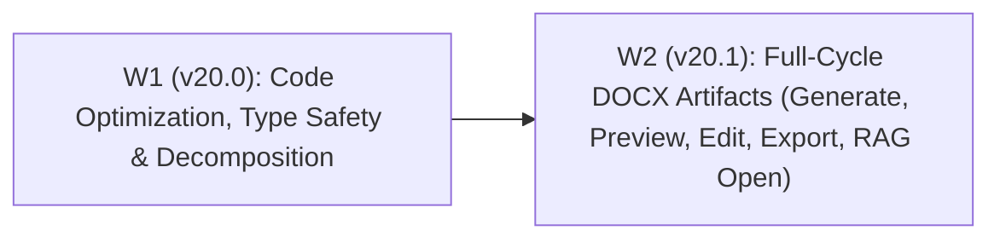
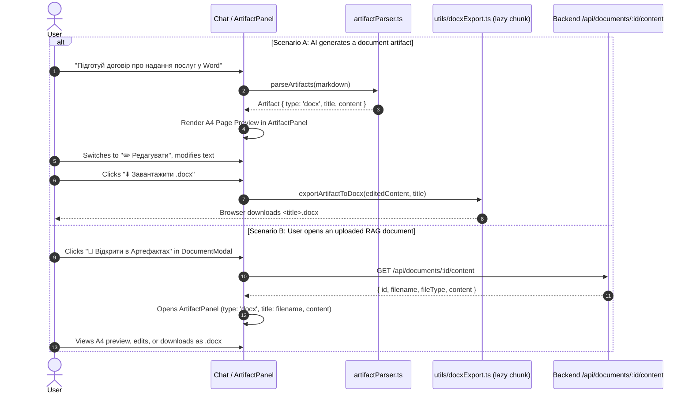

# Project Evolution Roadmap v20 — Code Optimization, Type-Safety Ratchet & Full-Cycle DOCX Artifacts

**Date:** 2026-11-07  
**Status:** Implemented (W1 code optimization, W2 docx artifacts). Closeout E2E: `e2e/docx-artifact.spec.ts`.  
**Parent:** Post v19.4 (Hardening, Provider Unification, Multi-User Readiness & Performance)  
**Target Deployment Profile:** Small trusted team (2–10 users) on a shared self-hosted server (Docker Compose behind TLS reverse proxy) + Electron desktop shell  
**Scope:** Two sequential gated waves:
1. **Wave 1 (v20.0):** Tooling & Ratchet Fix, Explicit-`any` Elimination, Oversized Module Decomposition, Schema & Orchestrator Alignment.
2. **Wave 2 (v20.1):** Full-Cycle `.docx` Document Artifacts (AI Generation, A4 Word Preview, In-Panel Live Editor, Dynamic OOXML `.docx` Export, and Opening Indexed RAG Documents in `ArtifactPanel`).

**Non-goals (for v20):**
- WYSIWYG rich-text editor libraries (TipTap / Lexical / Quill) inside `ArtifactPanel` — editing uses a lightweight structured Markdown/HTML editor with live A4 preview to preserve the $\le 350\text{ KB}$ gzip initial bundle budget.
- Retaining raw uploaded `.docx` binary files on disk after RAG indexing — document view/reconstruction uses ordered `document_chunks` stored in PostgreSQL.
- Breaking framework upgrades deferred to future major waves (React 19, Express 5, Prisma 8).

---

## 1. Post-v19 Audit Findings Driving v20

| # | Area | Severity | File / Line | Finding | Resolution in v20 |
|---|------|----------|-------------|---------|-------------------|
| A1 | CI / Tooling | High | `scripts/any-ratchet.mjs:24-37` | Spawning `npx.cmd` on Windows Node 24 fails with `EINVAL`; `JSON.parse(result.stdout \|\| '[]')` silently returns `0` warnings whenever ESLint crashes or fails to load a plugin. | Run `./node_modules/eslint/bin/eslint.js` via `process.execPath`; fail immediately on `result.error`, exit status $\notin \{0, 1\}$, or empty `stdout`. |
| A2 | Type Safety | Medium | `backend/src/**` (13 files) | 73 `@typescript-eslint/no-explicit-any` warnings remain across `chatController.ts`, provider services (`claudeService.ts`, `claude/formatters.ts`, `geminiService.ts`, `ollamaService.ts`, `openaiService.ts`), `tools/*`, and `tavilyProvider.ts`. | Replace `any` with explicit SDK / domain types and lower `scripts/any-baseline.json` to `0` for both `backend` and `frontend`. |
| A3 | Modularity | Medium | `frontend/src/hooks/useChatStream.ts` (544 lines) | Exceeds the 400-line ceiling by mixing SSE token buffering, `toolTraceRef` state machine (`onToolCall` / `onToolResult` / `onToolConfirmationRequired`), React Query cache updates, abort handling, and `/send` fallback. | Extract pure tool-trace state transitions and in-flight assistant message synchronization into `frontend/src/hooks/toolTraceReducer.ts`. |
| A4 | Modularity | Medium | `backend/src/services/tools/registry.ts` (427 lines) | Triggers ESLint `max-lines` warning (403 non-blank lines > 400 max) by defining all 10 built-in tools inline inside `ToolRegistry`. | Split tool definitions into `builtInReadTools.ts` (7 read tools) and `builtInWriteTools.ts` (3 write tools); keep `registry.ts` under 100 lines. |
| A5 | Duplication | Low | `frontend/src/components/ChatBoxOptimized.tsx:31-56` | `modelSupportsTools` duplicates model-substring heuristics from `backend/src/utils/modelCapabilities.ts`. | Extract `frontend/src/utils/modelSupportsTools.ts` prioritizing `supports_tools` from the backend model catalog. |
| A6 | Config / DB Drift | Medium | `backend/prisma/schema.prisma:81,210` & `registry.ts:327,394` | `UserSettings.maxTokens` and `LlmModel.maxTokens` default to `2000` in Prisma schema while application code defaults to `4096`. `update_settings` tool caps `max_tokens` at `8000` while UI and chat validators allow up to `32000`. | Align Prisma schema defaults to `4096` with a migration; raise `update_settings` tool `max_tokens` cap to `32000`. |
| A7 | Orchestrator | Medium | `backend/src/services/tools/orchestrator.ts:183-186` | If an LLM emits multiple write tool calls in one turn, only the first (`if (!writeToolFound)`) is captured and subsequent write calls are silently dropped without a `toolTrace` entry. | Record any additional write tool calls in `toolTrace` with `status: 'skipped'` and a clear diagnostic reason. |
| A8 | Repo Hygiene | Low | `.worktrees/` | Leftover empty `.worktrees` directory in repository root. | Remove `.worktrees` directory and add `.worktrees/` to `.gitignore`. |

---

## 2. Wave Architecture & Sequence



**Gate for every wave:**
1. TDD regression tests written first (red $\to$ green).
2. `npm run lint`, `npm run typecheck`, unit tests, and `node scripts/any-ratchet.mjs` pass with zero errors in both `backend` and `frontend`.
3. `npm run check:bundle --prefix frontend` passes ($\le 350\text{ KB}$ gzip initial JS budget).
4. Desktop unit tests (`npm --prefix desktop test`) and Playwright E2E suite pass.

---

## 3. Wave 1 (v20.0) — Code Optimization, Type Safety & Module Decomposition

### 3.1 Reliable ESLint Ratchet (`scripts/any-ratchet.mjs`)
- Invoke ESLint directly via `spawnSync(process.execPath, [eslintBin, '.', '-f', 'json'], { cwd, encoding: 'utf8', maxBuffer: 64 * 1024 * 1024 })` where `eslintBin` resolves to `path.join(root, project, 'node_modules', 'eslint', 'bin', 'eslint.js')`.
- Guard execution:
  - If `result.error` is defined, or `result.status !== 0 && result.status !== 1`, or `!result.stdout?.trim()`, log `result.stderr || result.error` and exit with code `1`.
- Update `scripts/any-baseline.json` to `{ "backend": 0, "frontend": 0 }` after eliminating all `explicit any` warnings.

### 3.2 Backend Type-Safety Cleanup (73 $\to$ 0 `any` warnings)
- **`backend/src/services/tools/types.ts` & `registry.ts`:** Type `RegisteredTool<TArgs = Record<string, unknown>>` with `Record<string, unknown>` and narrow arguments via helper guards inside each tool's `execute` and `describeProposal`.
- **Provider Services (`openaiService.ts`, `ollamaService.ts`, `geminiService.ts`, `claudeService.ts`, `claude/formatters.ts`):** Define explicit interfaces for SDK chunk/message shapes (`ClaudeContentBlock`, `GeminiCandidatePart`, `OllamaToolCallPayload`) instead of `: any` casts.
- **Controllers & Orchestrator (`chatController.ts`, `orchestrator.ts`, `actionResolver.ts`, `toolExecutor.ts`, `chat/search.ts`, `tavilyProvider.ts`):** Extend `StreamTurnResult` in `services/chat/types.ts` with optional `toolTrace?: ToolTraceEntry[]` and `status?: string` so `chatController.ts` no longer casts `result as any`.

### 3.3 Module Decomposition
- **Backend Tool Registry Split:**
  - `backend/src/services/tools/registry.ts` (~85 lines): `ToolRegistry` class, `register`, `get` (with doubled-name resilience), `getAll`, `getDefinitions`, singleton export.
  - `backend/src/services/tools/builtInReadTools.ts` (~210 lines): `search_documents`, `list_documents`, `read_memory`, `get_system_help`, `calculate`, `get_current_time`, `web_search`.
  - `backend/src/services/tools/builtInWriteTools.ts` (~150 lines): `add_user_memory_note`, `add_conversation_note`, `update_settings`.
- **Frontend Stream Hook Split:**
  - `frontend/src/hooks/toolTraceReducer.ts` (~140 lines): Pure functions `applyToolCallEvent(trace, payload)`, `applyToolResultEvent(trace, payload)`, `applyToolConfirmationEvent(trace, payload)`, and `upsertInFlightAssistantMessage(messages, inFlightIndex, trace)`.
  - `frontend/src/hooks/useChatStream.ts` (~310 lines): Delegates all tool-event mutations to `toolTraceReducer.ts`.
- **Frontend Model Capability Utility:**
  - Move `modelSupportsTools` from `ChatBoxOptimized.tsx` to `frontend/src/utils/modelSupportsTools.ts` and re-export for backwards compatibility with existing unit tests.

### 3.4 Schema, Validator & Orchestrator Alignment
- **Prisma Schema & Migration:**
  - Update `UserSettings.maxTokens` and `LlmModel.maxTokens` in `backend/prisma/schema.prisma` to `@default(4096)`.
  - Add migration `backend/prisma/migrations/20261107230000_align_max_tokens_default_4096/migration.sql`:
    ```sql
    ALTER TABLE "user_settings" ALTER COLUMN "max_tokens" SET DEFAULT 4096;
    ALTER TABLE "llm_models" ALTER COLUMN "max_tokens" SET DEFAULT 4096;
    ```
- **Tool Limit Alignment:**
  - In `builtInWriteTools.ts` (`update_settings`), change `max_tokens` schema `maximum` and runtime validation from `8000` to `32000`.
- **Multiple Write Tools Handling (`orchestrator.ts`):**
  - When a single model turn contains more than one write tool call, capture the first in `writeToolFound` for confirmation, and push each additional write tool call into `toolTrace` with `status: 'failed'`, `error: 'Одночасно можна запросити підтвердження лише для однієї дії запису; повторіть цю дію наступним кроком'`.

---

## 4. Wave 2 (v20.1) — Full-Cycle `.docx` Document Artifacts

### 4.1 Data Flow Overview



### 4.2 Artifact Types & Parser (`frontend/src/types/api.ts`, `frontend/src/utils/artifactParser.ts`)
- Update `Artifact` interface in `frontend/src/types/api.ts`:
  ```ts
  export interface Artifact {
    id: string;
    type: 'html' | 'svg' | 'docx';
    title: string;
    language: string;
    content: string;
  }
  ```
- Extend `parseArtifacts` in `frontend/src/utils/artifactParser.ts`:
  - Recognize code block languages `docx`, `document`, and `doc` as `type: 'docx'`, `language: 'markdown'`.
  - In `extractTitle`, when `type === 'docx'`, check in order:
    1. `<!-- title: ... -->` comment inside or immediately before the block.
    2. First Markdown heading `# Heading` inside `content`.
    3. `<title>` or `<h1>–<h6>` tag inside `content`.
    4. Preceding Markdown heading before the code block.
    5. Default: `'Документ Word (DOCX)'`.
- Update `backend/src/services/chat/systemContext.ts`:
  - Append a concise formatting rule to the system instructions so the model knows that when the user asks for a `.docx` / Word document, official letter, contract, or downloadable report, it should output a ` ```docx ` fenced block containing clean Markdown (`#` headings, paragraphs, bullet/numbered lists, Markdown tables).
- Update `backend/src/services/systemKnowledge/registry.ts`:
  - Update the `interactive-artifacts` knowledge card to mention `.docx` document generation, live editing, and Word export.

### 4.3 A4 Document Preview & Live Editor in `ArtifactPanel.tsx`
- **State management:**
  - `editedContent` state initialized from `artifact.content` and synchronized when `artifact.id` or streaming `artifact.content` updates (unless the user has manually edited `isDirty`).
  - Tabs in `ArtifactPanel`:
    - `👁️ Перегляд` — For `html` / `svg`, renders the existing sandboxed `<iframe>`. For `docx`, renders an A4 page container (`.artifact-docx-sheet`: white paper background, `color: #111827`, `max-width: 794px`, `min-height: 520px`, `padding: 2.25rem 2.5rem`, subtle page shadow, styled headings, bordered tables, and readable serif/sans-serif typography) using `react-markdown`.
    - `✏️ Редагувати` (shown for `type === 'docx'` and `type === 'html'`) — Full-height `<textarea>` bound to `editedContent` with a «Скинути зміни» (`Reset`) button when `isDirty` is true.
    - `💻 Код` — Read-only source view of `editedContent` with line count.
- **Download actions:**
  - When `artifact.type === 'docx'`, the primary download button reads `⬇️ Завантажити .docx` and invokes `downloadArtifactAsDocx(editedContent, artifact.title)`.
  - When `artifact.type === 'html'`, keep the existing `.html` download button and add a secondary `📄 .docx` button so any HTML report/artifact can also be exported to `.docx`.

### 4.4 Dynamic OOXML `.docx` Generator (`frontend/src/utils/docxExport.ts`)
- Add `"docx": "^9.5.0"` to `frontend/package.json` dependencies.
- Configure `frontend/vite.config.mjs` so `docx` is isolated in its own async chunk (never preloaded in `index.html`).
- Implement `buildDocxBuffer(content: string, title: string): Promise<Uint8Array>` and `downloadArtifactAsDocx(content: string, title: string): Promise<void>`:
  - Dynamically imports `const docx = await import('docx')`.
  - If `content` contains HTML markup without Markdown structure, converts basic HTML tags (`<h1>–<h6>`, `<p>`, `<ul>/<ol>/<li>`, `<table>/<tr>/<th>/<td>`, `<strong>/<b>`, `<em>/<i>`, `<br>`) into structured blocks first; otherwise parses Markdown lines:
    - `# / ## / ###` $\to$ `Paragraph` with `HeadingLevel.HEADING_1 / HEADING_2 / HEADING_3`
    - Markdown pipe tables (`| col1 | col2 |`) $\to$ `Table` with header shading and cell borders
    - Unordered (`- ` / `* `) and ordered (`1. `) lists $\to$ `Paragraph` with bullet / numbering prefix
    - Inline `**bold**`, `*italic*`, and `` `code` `` $\to$ `TextRun({ text, bold, italics, font })`
  - Uses Cyrillic-safe font family (`Arial` / `Calibri` / `Times New Roman`) with 24 half-point (12pt) body text and standard A4 page margins.

### 4.5 Opening Uploaded RAG Documents in `ArtifactPanel`
- **Backend Endpoint (`GET /api/documents/:id/content`):**
  - Route in `backend/src/routes/documents.ts`: `router.get('/:id/content', authenticateToken, getDocumentContent)`.
  - Handler `getDocumentContent` in `backend/src/services/documents/httpHandlers.ts` & method `DocumentService.getContent(id, userId)`:
    - Queries `Document` where `{ id, userId }`. If not found $\to$ `404`.
    - If `doc.status !== 'ready'` $\to$ `409 Conflict` (`Документ ще обробляється або пошкоджений`).
    - Fetches `document_chunks` ordered by `chunkIndex ASC`, joins chunk contents cleanly (deduplicating overlap where applicable or joining with `\n\n`), and returns:
      ```json
      {
        "id": 42,
        "filename": "contract.docx",
        "file_type": "application/vnd.openxmlformats-officedocument.wordprocessingml.document",
        "content": "..."
      }
      ```
- **Frontend Integration (`DocumentModal.tsx` & `ChatBoxOptimized.tsx`):**
  - Add `getContent: (id: number) => api.get<DocumentContentResponse>(\`/documents/\${id}/content\`)` to `frontend/src/services/api/documents.ts`.
  - In `DocumentModal.tsx`, for every document with `status === 'ready'`, add an action button `📄 Відкрити` (`aria-label="Відкрити документ в панелі артефактів"`).
  - Clicking `📄 Відкрити` fetches `documentsAPI.getContent(doc.id)`, constructs an `Artifact` (`{ id: \`doc-\${doc.id}\`, type: 'docx', title: doc.filename, language: 'markdown', content: res.data.content }`), calls `onOpenArtifact(artifact)`, and closes `DocumentModal`.

---

## 5. Error Handling & Security

- **XSS & Sandbox Isolation:** In `ArtifactPanel.tsx`, the A4 preview for `type === 'docx'` uses `react-markdown` without `rehype-raw` (HTML tags are stripped or escaped), and `html`/`svg` artifacts continue using the isolated `/artifact-sandbox.html` iframe with `injectArtifactGuard`.
- **Ownership Enforcement:** `GET /api/documents/:id/content` strictly scopes the Prisma query by `{ id, userId: req.userId! }` so users can never read another user's document chunks.
- **Bundle Budget Protection:** `docx` is loaded exclusively via dynamic `import('docx')` inside `docxExport.ts`; `npm run check:bundle --prefix frontend` enforces that initial gzipped JS remains $\le 350\text{ KB}$.

---

## 6. Testing Strategy

1. **Wave 1 Verification:**
   - Unit test for `scripts/any-ratchet.mjs` verifying non-zero exit when ESLint fails or `any` count exceeds baseline.
   - Unit tests for `frontend/src/hooks/toolTraceReducer.test.ts` covering `onToolCall`, `onToolResult`, `onToolConfirmationRequired`, and deduplication by `callId`.
   - Unit test in `backend/src/__tests__/toolOrchestrator.test.ts` verifying that multiple write tool calls in a single turn record `skipped` trace entries for secondary write calls.
   - ` backend` + `frontend` ESLint passes with **0 errors and 0 `@typescript-eslint/no-explicit-any` warnings**.
2. **Wave 2 Verification:**
   - `frontend/src/utils/artifactParser.test.ts`: parses ` ```docx ` and ` ```document ` blocks, extracts `# Heading` titles, and handles unclosed streaming blocks.
   - `frontend/src/utils/docxExport.test.ts`: generates a non-empty valid ZIP/OOXML (`PK\x03\x04` magic bytes) `Uint8Array` from Markdown with Cyrillic headings, bold text, lists, and tables.
   - `frontend/src/components/chat/ArtifactPanel.test.tsx`: renders A4 preview for `type: 'docx'`, allows editing in the `✏️ Редагувати` tab, resets changes, and triggers `.docx` download with the edited content.
   - `backend/src/__tests__/documents.test.ts`: tests `GET /api/documents/:id/content` for 200 (ready document), 409 (pending/failed document), and 404 (other user's or missing document).
   - E2E Playwright test (`e2e/v16-features.spec.ts` or `e2e/docx-artifact.spec.ts`): verifies opening a `docx` artifact, editing its content, and triggering a `.docx` file download.
